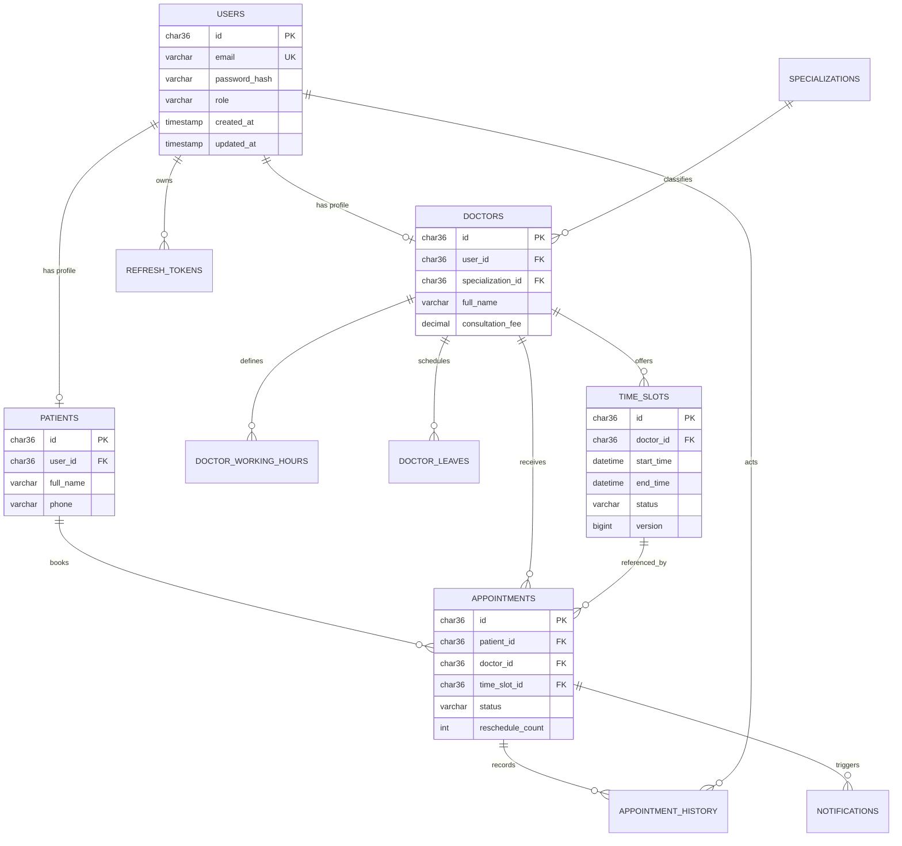

# Hospital Appointment Booking API

A layered REST API built with Java 21, Spring Boot 3, Spring Security, Spring Data JPA, MySQL, and Flyway. The service supports JWT authentication, doctor/patient profiles, doctor availability, concurrency-safe appointment booking, appointment lifecycle rules, email notifications, and admin reports.

## Architecture

```text
org.hospital.appointment
├── controller   REST endpoints and request binding
├── dto          Validated request/response records
├── domain       JPA entities and enums
├── repository   Spring Data repositories and report queries
├── security     JWT filter, authorization, entry point, and access-denied handler
├── service      Business rules, scheduling, and notifications
└── exception    API exceptions and global error handling
```

## ER diagram



Flyway owns the schema (`src/main/resources/db/migration`). Hibernate runs in `validate` mode. The database enforces unique user email, specialization name, doctor/start-time slots, and supporting report/search indexes. `TimeSlot` and `Appointment` use optimistic versions; the service also locks the patient's row to serialize that patient's bookings and prevent concurrent overlap.

## Run locally

Requirements: JDK 21+, Maven 3.9+, Docker.

1. Copy `.env.example` to `.env` and replace every placeholder (do not commit `.env`):

   ```sh
   cp .env.example .env
   ```

   Set a strong, unique `JWT_SECRET` and credentials in deployed environments. Bootstrap admin variables are optional; if supplied, both must be present and the password must be 12–72 characters. The application creates the admin only when that email does not already exist. The committed application configuration contains no usable credentials or JWT signing key.

2. Start the API and MySQL:

   ```sh
   docker compose up --build
   ```

   The API listens on `http://localhost:8080`; MySQL is available on port `3306`, and Mailpit's local email inbox is at `http://localhost:8025`. Flyway applies migrations at startup. With `DEMO_DATA_ENABLED=true` (the Compose default), four fictional doctors and weekday appointment slots are added for booking demos. Set it to `false` to disable demo data.

3. Open Swagger UI at `http://localhost:8080/swagger-ui.html`.

For a local Maven run, start a MySQL 8 database and set `DB_URL`, `DB_USERNAME`, `DB_PASSWORD`, and `JWT_SECRET`, then run `mvn spring-boot:run`.

## Main API

| Capability | Endpoint |
|---|---|
| Patient registration, login, refresh | `POST /api/auth/register`, `/api/auth/login`, `/api/auth/refresh` |
| Search doctors | `GET /api/doctors?name=&specializationId=&minFee=&maxFee=&page=&size=` |
| Manage own doctor profile/hours/leaves | `PATCH /api/doctors/me`, `PUT /api/doctors/me/working-hours`, `POST /api/doctors/me/leaves` |
| Patient self-profile | `GET/PATCH /api/patients/me` |
| Available slots | `GET /api/doctors/{doctorId}/slots?date=YYYY-MM-DD` |
| Book/cancel/reschedule appointments | `POST /api/appointments`, `POST /api/appointments/{id}/cancel`, `POST /api/appointments/{id}/reschedule` |
| Own appointment schedule/history | `GET /api/appointments/mine`, `GET /api/appointments/{id}/history` |
| Admin provision doctors/specializations | `POST /api/admin/doctors`, `POST /api/specializations` |
| Admin reports | `GET /api/admin/reports/{appointments-per-doctor-month,cancellation-rate,peak-booking-hours,top-specializations}` |

Access tokens are short-lived JWTs. Refresh tokens are random opaque secrets stored only as SHA-256 hashes, rotated on refresh, and revoked atomically. Registration creates a patient account; an admin provisions doctor accounts. All protected APIs require a bearer access token. Error responses use a consistent JSON envelope, with conflicts returned as HTTP 409.

Doctor working hours use ISO day names (`MONDAY`–`SUNDAY`) and local clock times. Slot generation runs daily (configurable with `app.slots.generation-cron`) and skips leaves; `app.slots.generation-days` controls the horizon. Appointments may be cancelled or rescheduled at least two hours beforehand; each appointment allows at most three reschedules. The scheduler checks every 15 minutes for reminders about appointments in the next 24 hours.

## Configuration

| Variable | Default | Purpose |
|---|---|---|
| `DB_URL` | Local MySQL URL | JDBC connection |
| `DB_USERNAME`, `DB_PASSWORD` | `hospital` | Database credentials |
| `JWT_SECRET` | Required | HMAC key, at least 32 UTF-8 bytes |
| `JWT_ACCESS_TOKEN_MINUTES` | `15` | Access-token lifetime |
| `JWT_REFRESH_TOKEN_DAYS` | `30` | Refresh-token lifetime |
| `SLOT_GENERATION_DAYS` | `30` | Future availability horizon |
| `BOOTSTRAP_ADMIN_EMAIL`, `BOOTSTRAP_ADMIN_PASSWORD` | unset | Optional initial admin |
| `MAIL_HOST`, `MAIL_PORT` | `localhost:1025` | SMTP configuration |
| `NOTIFICATION_RETRY_ATTEMPTS` | `3` | Async email attempts |

## Verification

```sh
mvn test
mvn verify
```

JUnit/Mockito unit tests run without external services. MySQL integration tests use Testcontainers and are skipped when Docker is unavailable. GitHub Actions runs verification on Java 21. See `docker-compose.yml` for the local service setup.

## Frontend

The React + Vite JavaScript frontend lives in [`frontend/`](frontend/README.md). Start the API, then run `npm install` and `npm run dev` from that directory. Set `VITE_API_BASE_URL` in `frontend/.env` if the backend is not at `http://localhost:8080`. The frontend includes light/dark themes, English/Hindi/Telugu, live availability refresh, booking confirmation alerts, and the backend's asynchronous email confirmation flow. Local Docker Compose captures confirmation email in Mailpit at `http://localhost:8025`.
